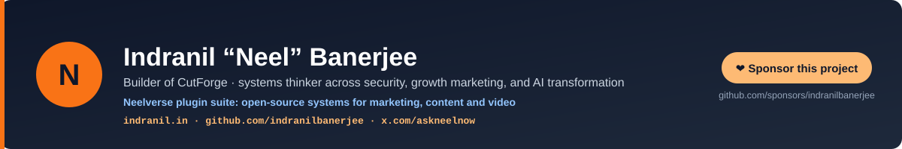
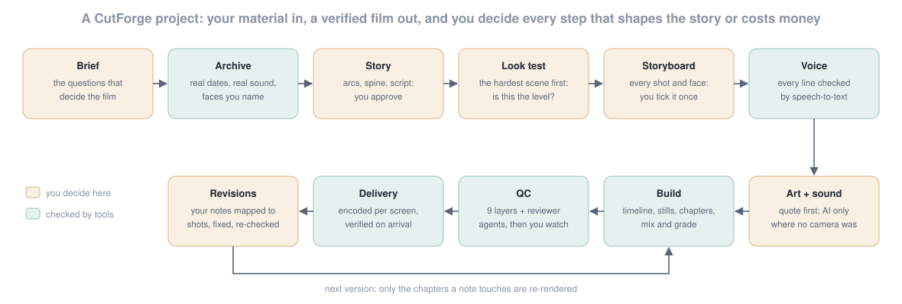

# CutForge: Video Creation and Editing for Claude

> **A client hands you 3,000 phone photos, 200 clips and a deadline: a 15-minute film for a family celebration, or a 60-second brand film by Friday. The last attempt looked like a slideshow, the narrator mispronounced a name, a cousin was labelled as the father, and the music stopped dead between scenes.**

Say "make a film from our photos" and CutForge runs the job the way an editor would: brief, archive research, story, a look test, a storyboard the client ticks once, verified narration, designed sound, a code-built render, nine QC layers, delivery and revision rounds. Every time in the film is derived from the measured narration, so a re-recorded line re-times its scene by itself. Every fix re-renders one chapter, not the whole film.

Open-source video creation and editing plugin, **from raw footage to final cut**: **13 skills · 4 reviewer agents · a tested engine of 48 tools (Remotion, ffmpeg, Python) · 0 hooks · 0 MCP servers**. Built from a real 20-minute production and every mistake made in it. Installs on **Claude Code** (CLI + IDE), **Anthropic Cowork**, **OpenAI Codex**, **Cursor 2.5+**, **GitHub Copilot CLI**, **Google Antigravity 2.0**, **Hermes Agent**, **OpenClaw** and **Grok**, plus 35+ Agent Skills platforms. Created by [Indranil Banerjee](https://indranil.in) · [LinkedIn](https://www.linkedin.com/in/askneelnow/) · [X](https://x.com/askneelnow).

[](CHANGELOG.md)
[](LICENSE)
[](https://github.com/indranilbanerjee/cutforge/stargazers)
[](tests/)
[](#supported-surfaces-v101)
[](#the-engine)

[](https://github.com/sponsors/indranilbanerjee)

> 🆕 **Just shipped: v1.0.1 (October 17, 2026). CutForge installs cleanly on Hermes Agent: one source line no longer looks like hidden text to its install-time scanner, and a guard keeps it that way. v1.0.0, the first public release, has 13 skills, 4 reviewer agents and an engine proven end to end on a real production.** [Current release](#current-release-v101) · [Changelog](CHANGELOG.md)

```bash
# Install in Claude Code:
/plugin marketplace add indranilbanerjee/neels-plugins
/plugin install cutforge@neels-plugins

# Install on Hermes Agent (Nous Research):
hermes plugins install indranilbanerjee/cutforge

# Install on OpenClaw:
openclaw plugins install git:github.com/indranilbanerjee/cutforge

# Install on Grok (xAI Build CLI):
grok plugin install indranilbanerjee/cutforge
```

> If CutForge saves you a week of editing, [give it a star ⭐](https://github.com/indranilbanerjee/cutforge/stargazers). It is the single thing that helps other people find it.

## Try this first

Install, then ask in plain words. Each of these requests reaches the right skill.

| You type | What happens |
|---|---|
| "make a 10-minute film from our family photos" | The full method starts: a one-screen brief, then the archive pass, the story and a look test before anything long is rendered |
| "go through these photos and find the best moments of 2024" | Real capture dates, monthly peaks and silences, contact sheets, clip strips, the real sounds inside the clips, face groups for you to name |
| "write the story for the film" | A treatment with arcs, a hidden spine, plants and payoffs, a beat map for kids and adults, and the narration script |
| "it looks like a slideshow" | Phone photos framed as prints, triptychs, pages and living photos with depth, cut to the music, with stills checked before rendering |
| "the voice says the name wrong" | A respell layer for the voice engine while the captions keep the right spelling, then every line re-checked by speech-to-text |
| "it stops abruptly between scenes" | The timing and audio checks find every short tail, dead-air gap and cut-off sound, and the mix gets bridges across every chapter |
| "here are my notes on the cut" | Each note mapped to its shot and its cause, the smallest rebuild planned, fixes verified, and new timestamps reported back |
| "make a reel for the launch, and a 16:9 version" | Hook, proof and CTA in 15 seconds, captions inside the platform-safe zone, a claims ledger, and every format encoded |

### What CutForge will never do

- **Put AI on a real person's face.** No generative edits, motion or invented faces on real people, children above all. AI goes only where no camera was, and a face guard refuses inputs that contain a face.
- **Guess who someone is.** Face clustering sorts; only you name people. Identities, relations, rituals, dates and quotes are confirmed in one batched round.
- **Spend on a paid voice or AI service before you say go.** Paid tools refuse to run without a `GO_AHEAD.txt` and stop at your cap; every call is logged.
- **Clone a voice without its owner's consent,** or clone someone who has died (their real recordings are used instead).
- **Delete or overwrite your files.** It works on copies and adds new files in a dedicated folder.
- **Ask for an API key in the chat.** Keys come from environment variables or a key file.

### What it costs

- **The plugin is free** (MIT-licensed).
- **Model usage (tokens).** On a subscription (Claude Pro, Max, Team or Enterprise in Claude Code or Cowork; a ChatGPT plan in Codex; a Cursor or Copilot plan) tokens count against your plan's usage limits. Only pay-as-you-go API users pay per token.
- **Rendering is your own compute.** Remotion, ffmpeg and the Python tools run on your machine: no cloud render fees. About 20 minutes of 1080p film renders in 5-6 hours on 2 CPU cores, 3-5 times faster on an 8-core desktop with a GPU.
- **Paid voice and AI art are optional** and billed by the provider you connect with your own key (Sarvam, ElevenLabs, OpenAI, WaveSpeed). A placeholder voice and the whole render, mix and QC pipeline work with no key at all.
- **Remotion's own licence:** free for individuals and companies of up to 3 people; larger companies need a Remotion Company License for commercial work.

## How it works



The amber steps are yours: the brief, the story, the look, the photo map, the budget and your notes. Everything else is checked by tools before you see it.

**Show, don't describe.** A 30-60 second look test of the hardest scene comes before the full script. Stills come before renders, and short previews before masters. Clients judge a render in seconds; they cannot judge a paragraph.

**Every time is derived.** `film/timeline.py` turns measured narration plus breathing room into every shot's length and writes one timeline that the picture, the captions and the mixer all read. Change a line and the whole chapter re-flows consistently. Narration longer than a fixed shot is an error; a tail shorter than 0.6 s is a warning.

**Real first, AI last.** Phone media is framed, never stretched or blur-filled. The real sound inside the clips (a conch on the morning of a ceremony, festival drums, laughter) is found automatically and used before any library effect.

## Quick Start

1. **Install.** In Claude Code:

   ```
   /plugin marketplace add indranilbanerjee/neels-plugins
   /plugin install cutforge@neels-plugins
   ```

   In Cowork, use the Plugins panel instead (Add marketplace, paste `indranilbanerjee/neels-plugins`, install CutForge). Other hosts are under [Supported surfaces](#supported-surfaces-v101).
2. **Prove the toolchain once.** Ask "start a CutForge demo project in D:/Films/demo", or run it yourself:

   ```bash
   python <plugin>/engine/new_project.py "D:/Films/demo" --title "The Lamp" --demo
   cd "D:/Films/demo" && npm install && python tools/setup_local.py
   python tools/mix/synth.py && python tools/demo_assets.py && bash tools/text/shapeall.sh
   python tools/voice/gen_vo.py && python film/timeline.py
   CONC=4 bash tools/render/pipeline.sh all
   python tools/mix/film_mix.py && VER=v1 bash tools/render/assemble.sh
   ```

   That renders a one-minute demo film from procedural media and verifies every frame.
3. **Start a real project.** "Make a film from our photos for our anniversary" or "brief for a 60-second brand film". The `cutforge` skill takes over from the brief.

> **Claude answers in chat instead of using a CutForge skill?** Claude Code lists every installed skill in a budget of 1% of the context window. With several plugins installed, only skill names may fit. Add `"skillListingBudgetFraction": 0.05` to your Claude Code `settings.json`, or start a skill by name, e.g. `/cutforge:cutforge`.

## Who this is for

| If you're a... | Start with | What you get |
|---|---|---|
| **Family or individual with years of phone media** | "make a film from our photos for ..." | A story-led film, not a slideshow: verified people and dates, your own voices and sounds, a projector-ready file and a screening run sheet |
| **Video editor or producer** | `/cutforge:storyboard-and-look`, `/cutforge:render-and-assemble` | A data-driven edit: layouts as JSON, timing derived from narration, chunked resumable renders, one-chapter fixes |
| **Agency or brand team** | `/cutforge:marketing-video` | Hook-proof-CTA scripts, captions in safe zones, a claims ledger, multi-format encodes and a sign-off sheet |
| **Pharma, BFSI or regulated marketer** | `/cutforge:marketing-video` + the `compliance-reviewer` agent | UCPMP, DMR Act, SEBI, IRDAI and ASCI rules checked with sources, mandatory supers timed, AI content labelled |
| **Documentary or tribute maker** | `/cutforge:media-archive`, `/cutforge:story-design` | Library statistics, real-sound discovery, sourced quotations, sensitive periods handled the way the family decides |

## Core principle

**Real footage is the film. AI only paints where no camera was.**

A face that looks like a parent in a crowd may be a cousin. A "family celebration" may be another family's. A famous line may not exist in the poet's collected works. CutForge treats every fact on screen as a claim that needs a source, and every abrupt stop as a bug with a mechanism.

## The 13 skills

| Skill | What it does |
|---|---|
| `cutforge` | The orchestrator: twelve non-negotiables, eleven phases with gates, when to ask and when to proceed |
| `video-brief` | The intake: purpose, playback device, people map, red lines, sensitive periods, budget, client inbox, a live show page |
| `media-archive` | Inventory with real capture dates, GPS and rotation; stats, contact sheets, clip strips, sound events, face clusters, semantic search, the photo map |
| `story-design` | Logline, frame, three arcs, a hidden spine, motifs, plants and payoffs, a beat map for every audience, narration rules, `script.json` |
| `storyboard-and-look` | The look test, film language, `shots.json` layouts, safe areas, complex-script typography, the storyboard page |
| `voice-and-narration` | Casting brief, audition page, providers, respell layer, per-line direction, speech-to-text verification, recorded takes |
| `sound-design` | Real sound first, licences per use, music-first editing with a beat finder, a cue sheet on the timeline, bridges, loudness |
| `visuals-and-ai-art` | The real-first ladder: layouts, light, 2.5D parallax, straightening, cut-out composites, AI stills and motion with a face guard |
| `render-and-assemble` | Timeline, stills, chunked resumable chapter renders, grade, mix, assembly, verification; partial re-renders; troubleshooting |
| `video-qc` | Nine QC layers, still-sheet review, audio flags, the report format and a full pre-delivery checklist |
| `revision-round` | Notes to a NOTES table, a feedback decoder ("abrupt", "slideshow", "primitive"), the smallest rebuild, verified fixes |
| `video-delivery` | Encode presets per destination, verified transfers, rebuilding on the far side, the project hand-off, a screening run sheet |
| `marketing-video` | Objective and CTA, hook-proof-CTA, captions, claims ledger, pharma and BFSI rules, consent, AI labels, brand kits, exact lengths |

Four agents review work they did not build: `story-editor`, `film-qc-reviewer`, `compliance-reviewer` and `archive-scout`.

## The engine

`engine/new_project.py` scaffolds a project from `engine/template/`: a Remotion 4 project plus Python tools, Windows-safe and portable.

- **Picture:** one composition per chapter. `AutoChapter` renders shots from `film/shots.json` layouts with no code (living, portrait, prints, triptych, title, card, page, black); hand-built chapters for choreography. Captions sized to at least 1/20 of the frame in every format, and vertical defaults that keep text inside the platform-safe zone. HarfBuzz-shaped titles for complex scripts; OFL fonts for Indic scripts included.
- **Voice:** Sarvam, Sarvam voice clone, ElevenLabs, OpenAI or a placeholder; a respell layer; pace per line; -18 LUFS; speech-to-text verification with honest CHECK and UNVERIFIED lists; recorded human takes imported and protected.
- **Sound:** a Python mixer with buses, ducking, minimum fade-outs, chapter bridges, room tone and two-pass loudness; mix windows that widen for long cues; stale chapters re-mixed automatically; synthesised beds and bells; a beat, bar and phrase finder.
- **Look:** an ffmpeg grade (3D LUT, halation, vignette, grain) with presets warm, pop, neutral, bw and doc.
- **QC:** timeline checks, audio drops, dead air and loudness, still sheets with safe zones, frame and decode verification, story chronology, cast and reuse, a time-to-shot lookup, and the storyboard and photo-map page with saved notes.
- **Archive:** inventory with EXIF, GPS and rotation, stats, contact sheets, clip strips, real-sound events, face clusters (YuNet + SFace) and OpenCLIP semantic search.
- **VFX:** Depth Anything V2 Small depth maps and parallax plates, person cut-outs, perspective straightening, hosted AI image and video with a budget gate, a face guard and a provenance log, motion-interpolated retiming.
- **Delivery:** encode presets (projector, YouTube, Reels, WhatsApp, broadcast, archive) with two-pass loudness, verified resumable parts, resumable copies, lossless chapter recovery from a delivered master.

## Proven on a real production

CutForge was distilled from a 20-minute storybook film built end to end by Claude: seven look tests, two full cuts, 131 narration lines verified one by one, ten chapters rendered in resumable chunks and a 3.3 GB master delivered over a slow link. [`docs/lessons-learned.md`](docs/lessons-learned.md) records every mistake and the rule that now prevents it; [`docs/case-study.md`](docs/case-study.md) tells the production phase by phase, anonymised.

## Supported surfaces (v1.0.1)

| Platform | Install command | Manifest path | Status |
|---|---|---|---|
| **Claude Code** CLI + IDE extensions | `/plugin install cutforge@neels-plugins` | `.claude-plugin/plugin.json` | Full support (canonical) |
| **Anthropic Cowork** | Plugins UI → Add marketplace → `indranilbanerjee/neels-plugins` → Install CutForge | same `.claude-plugin/` files | Full support (UI install) |
| **OpenAI Codex** CLI + IDE + App | `codex plugin marketplace add indranilbanerjee/neels-plugins` then `codex plugin add cutforge@neels-plugins` | `.codex-plugin/plugin.json` | Full skills support |
| **Cursor 2.5+** | In any Cursor Agent chat: `/add-plugin cutforge@https://github.com/indranilbanerjee/cutforge` | `.cursor-plugin/plugin.json` | Skills + agents |
| **GitHub Copilot CLI** | `copilot plugin marketplace add indranilbanerjee/neels-plugins` then `copilot plugin install cutforge@neels-plugins` | `.github/plugin/plugin.json` | Full skills support |
| **Google Antigravity 2.0** CLI + IDE | `agy plugin install https://github.com/indranilbanerjee/cutforge` | `gemini-extension.json` (+ `AGENTS.md` context) | Full skills support |
| **Hermes Agent** (Nous Research) | `hermes plugins install indranilbanerjee/cutforge` | `plugin.yaml` + `__init__.py` | Native plugin: the adapter registers all 13 skills |
| **OpenClaw** | `openclaw plugins install git:github.com/indranilbanerjee/cutforge` | `openclaw.plugin.json` (+ `package.json` `openclaw` block) | Native plugin |
| **Grok** (xAI Build CLI) | `grok plugin install indranilbanerjee/cutforge`, or `grok plugin marketplace add indranilbanerjee/neels-plugins` then `grok plugin install cutforge` | `.grok-plugin/plugin.json` + `.grok-plugin/marketplace.json` | Full skills support |

**Works on 35+ more Agent Skills platforms** without a per-platform manifest (Goose, OpenHands, OpenCode, Junie, Gemini CLI, Roo Code, Cline, Windsurf, Kiro, Amp and more): point any Agent-Skills client at `https://github.com/indranilbanerjee/cutforge/tree/main/skills`.

## Architecture

- **13 skills** with `references/` for detail, written as instructions for the agent
- **4 reviewer agents** (Claude surfaces; elsewhere, ask for an independent review with the agent file's instructions)
- **48 engine tools**: the scaffold, the timeline, the renderer and 45 project tools for archive, voice, mix, grade, QC, VFX and delivery
- **3 reference docs**: the lessons ledger, the anonymised case study, and licensing, platform specs and Indian ad compliance with sources
- **0 hooks, 0 MCP servers, no telemetry**

## Requirements

- Node 18+, Python 3.10+, ffmpeg and ffprobe on PATH. On Windows, Git Bash for the `.sh` scripts and `setx PYTHONUTF8 1` once.
- Python packages: numpy, soundfile, pedalboard, pyloudnorm, rapidfuzz, opencv-python, pillow, scipy (`python tools/setup_local.py` lists anything missing). Optional: onnxruntime (depth, faces), rembg (cut-outs), open_clip_torch + torch (semantic search).
- Disk: 15-25 GB of working space for a 20-minute 1080p film. Put projects on a data drive.

## Updating

```bash
/plugin marketplace update neels-plugins
/plugin update cutforge@neels-plugins
```
Projects keep their own copy of the engine, so an update never changes a film in progress. To bring a fix into a project, copy the changed tool from `engine/template/` into it.

## Current Release (v1.0.1)

**v1.0.1:** an install fix for Hermes Agent. The voice tool held two invisible joiner characters in its source, which an install-time security scanner reads as hidden text; they are now written as escape codes, and a new guard checks every shipped file against the scanner's patterns.

**v1.0.0:** the first public release. Thirteen skills and four reviewer agents covering the whole job from brief to delivery, and an engine proven end to end: a fresh demo project renders, mixes, assembles and verifies with no manual step, in landscape, vertical and square. Built in one pass with an independent review that found three blocking issues before release (a one-chapter re-mix that could desync later chapters, a blur-filled portrait layout, and identifying details in the case study), all fixed and covered by tests.

Older releases are in [CHANGELOG.md](CHANGELOG.md).

## Documentation

- **[User Guide](docs/USER-GUIDE.md):** a walkthrough from the first request to the screening
- **[Lessons learned](docs/lessons-learned.md):** every mistake from a real production and the rule that prevents it
- **[Case study](docs/case-study.md):** that production, phase by phase, anonymised
- **[Licensing and compliance](docs/compliance-and-licensing.md):** tool licences, 2026 platform specs, ASCI, pharma, BFSI, synthetic media, EU AI Act
- **[Contributing](CONTRIBUTING.md)** · **[Security](SECURITY.md)** · **[Privacy](PRIVACY.md)** · **[Changelog](CHANGELOG.md)**

## Star history

[](https://star-history.com/#indranilbanerjee/cutforge&Date)

---

## About the maintainer

CutForge is built and maintained by **[Indranil “Neel” Banerjee](https://indranil.in)**: a builder and systems thinker with roots in information security and a second act across growth marketing, enterprise digital operations and AI transformation. This repository is one public implementation of a broader focus on trustworthy AI execution: preserve context, make evidence inspectable, and keep people at the decisions that matter.

- 🌐 **Website:** [indranil.in](https://indranil.in)
- 💼 **LinkedIn:** [linkedin.com/in/askneelnow](https://www.linkedin.com/in/askneelnow)
- 🐦 **X / Twitter:** [@askneelnow](https://x.com/askneelnow)
- 💻 **GitHub:** [@indranilbanerjee](https://github.com/indranilbanerjee)
- 📦 **Other plugins:** [Digital Marketing Pro](https://github.com/indranilbanerjee/digital-marketing-pro) · [ContentForge](https://github.com/indranilbanerjee/contentforge) · [SocialForge](https://github.com/indranilbanerjee/socialforge)
- 🐛 **Bug reports:** [GitHub Issues](https://github.com/indranilbanerjee/cutforge/issues)
- 🔒 **Security:** [Private Security Advisory](https://github.com/indranilbanerjee/cutforge/security/advisories/new) (see [SECURITY.md](SECURITY.md))

If CutForge saves you time, [⭐ star the repo](https://github.com/indranilbanerjee/cutforge/stargazers). Sharing it on **LinkedIn** or **X** helps people discover it too.

---

## Contributing

PRs welcome, especially new layouts, voice providers, Indic-script typography, platform specs and compliance rules with primary sources. See [CONTRIBUTING.md](CONTRIBUTING.md) for the workflow and [`.github/PULL_REQUEST_TEMPLATE.md`](.github/PULL_REQUEST_TEMPLATE.md) for the checklist. All contributors are expected to follow the [Code of Conduct](CODE_OF_CONDUCT.md). Security issues: use [Private Security Advisories](https://github.com/indranilbanerjee/cutforge/security/advisories/new), never public issues.

---

## Neelverse plugin suite

CutForge is part of the **Neelverse plugin suite** by [Indranil Banerjee](https://indranil.in): four open-source plugins that work together.

| Plugin | What it does | Install |
|--------|-------------|---------|
| **[Digital Marketing Pro](https://github.com/indranilbanerjee/digital-marketing-pro)** | End-to-end marketing engagement methodology: 12-Part Strategy Flow, Four Core Documents, Two-Views Model | `/plugin install digital-marketing-pro@neels-plugins` |
| **[ContentForge](https://github.com/indranilbanerjee/contentforge)** | Publication-ready content through a 10-phase pipeline: research, fact-check, draft, SEO, humanize, `.docx` with C2PA signing | `/plugin install contentforge@neels-plugins` |
| **[SocialForge](https://github.com/indranilbanerjee/socialforge)** | Social media calendar automation with AI image and video generation and C2PA signing | `/plugin install socialforge@neels-plugins` |
| **CutForge** (this plugin) | Video creation and editing: story-led films, brand films, explainers and ads from your own footage | `/plugin install cutforge@neels-plugins` |

**Use together:** plan the campaign in Digital Marketing Pro, write the article in ContentForge, make the social posts in SocialForge, and cut the brand film or explainer in CutForge.

```
claude plugin marketplace add indranilbanerjee/neels-plugins
claude plugin install cutforge@neels-plugins
```

## Sponsor this project

This plugin is MIT-licensed, free to use commercially, and collects no telemetry. Sponsorship pays for the unglamorous half of keeping it accurate: provider API changes, platform spec updates, compliance passes when guidance moves, and issue triage.

If it saves you time, you can [sponsor the work](https://github.com/sponsors/indranilbanerjee). Sponsors from $25/mo are listed in [SPONSORS.md](SPONSORS.md).

[](https://github.com/sponsors/indranilbanerjee)

---

## License

MIT, see [LICENSE](LICENSE). Free to use commercially. Third-party components keep their own licences: the bundled fonts are SIL OFL (licence files alongside), and models downloaded on first use are listed in [docs/compliance-and-licensing.md](docs/compliance-and-licensing.md).

---

<sub>Made with care by [Indranil Banerjee](https://indranil.in) · MIT-licensed · [⭐ Star the repo](https://github.com/indranilbanerjee/cutforge) if it helps you</sub>
